# FacilityCore — data model and flows

Product Phase 1. One schema, drawn in parts so a page stays readable. The single diagram with every column is in `docs/erd.md`. The sequences are the flows to build.

Print this to PDF from a preview that draws Mermaid. A plain text converter will show the diagram source instead of the picture. Landscape for the overview.

Money is integer paise. A positive ledger amount means the flat owes the society. Dates and times are stored in UTC and shown in Asia/Kolkata.

## Rules the schema enforces

- One database, many societies. Every business row carries `society_id`. A query that can see a second society is a bug.
- `APP_USER` is global, keyed by mobile. A system admin has a role row with no society. Everyone else acts inside one society per session.
- A session token carries one role. That token cannot call another role’s actions.
- Guards have no account. SOS uses `SOCIETY.duty_guard_mobile`.
- One flat has one open bill payer. Extra phones on the flat can view, pay, and complain. Only the bill payer is reminded.
- One flat has at most one bill for a given month. Overdue is calculated from the balance and the due date. It is not a stored balance and not a bill status.
- A sent bill is never edited in place. A correction is a new adjustment line plus a ledger row, with the person, the time, and the reason.
- Payment rows are never deleted. A mistake is a reversing ledger row and a new row.
- A UPI reference on a reported or confirmed payment cannot be used again. A rejected reference can be sent again.
- Late fees pause only while a payment is `reported`. A rejection accrues the waiting days. Confirm stops the fee.
- Incoming money clears late fees first, then the oldest bill. Extra money is an advance (negative balance) or a recorded refund.
- An interior-work deposit has its own rows. It never posts to `LEDGER_ENTRY`.
- `PROVIDER_PAYMENT` has no foreign key to `BILL`, `LEDGER_ENTRY`, or `PAYMENT`. Service money cannot reduce dues. There is no screen for it in this phase.
- `AUDIT_EVENT` and `LEDGER_ENTRY` are append-only.
- There is no vendor, phonebook, visitor, face-template, gateway, or commission table.

Role names below use Secretary for the BRD’s Builder/Admin role.

| Action | System admin | Secretary | Treasurer | Facility manager | Resident |
| --- | --- | --- | --- | --- | --- |
| Create a society, set Draft / Active / Suspended, grant or remove a committee role | yes | | | | |
| Flats, import, opening balances, charges, settings, handover, notices, polls, documents | | yes | | | |
| Send bills, record cash or cheque, defaulter list, reports, money history | | yes | yes | | |
| Confirm or reject a reported UPI payment | | | yes | | |
| Waive a late fee, and only with a reason | | yes | | | |
| Complaints | | yes | | yes | own flat |
| Vote, read notices and society documents, SOS, own statement | | | | | yes |
| Apply a provider payment to dues | no | no | no | no | no |

While a society is **Draft**, the secretary can sign in and load data. Residents cannot. **Suspended** revokes every session for that society. System admin is outside the society and can still open it.

## 1. Overview

No columns here. The later diagrams define them. `PROVIDER_PAYMENT` is on this map and has no line to `BILL` or `LEDGER_ENTRY`.

```mermaid
erDiagram
    APP_USER ||--o{ SESSION : "opens"
    APP_USER ||--o{ ROLE_ASSIGNMENT : "holds"
    SOCIETY |o--o{ ROLE_ASSIGNMENT : "scopes"
    SOCIETY ||--o{ FEATURE_FLAG : "switches"
    SOCIETY ||--o{ WING : "has"
    SOCIETY ||--o{ FLAT_CATEGORY : "defines"
    SOCIETY |o--o{ SESSION : "context"
    SOCIETY ||--o{ FLAT : "contains"
    WING ||--o{ FLAT : "groups"
    FLAT_CATEGORY ||--o{ FLAT : "classifies"
    APP_USER ||--o{ OCCUPANCY : "lives or owns"
    FLAT ||--o{ OCCUPANCY : "has people"
    SOCIETY ||--o{ PARKING_SLOT : "registers"
    WING ||--o{ PARKING_SLOT : "locates"
    FLAT |o--o{ PARKING_SLOT : "may use"
    FLAT ||--o{ VEHICLE : "keeps"
    PARKING_SLOT |o--o{ VEHICLE : "may hold"
    FLAT ||--o{ FLAT_FILE : "stores papers"
    FILE_OBJECT ||--o{ FLAT_FILE : "is the bytes"
    SOCIETY ||--o{ IMPORT_BATCH : "loads"
    SOCIETY ||--o{ CHARGE_ITEM : "prices"
    FLAT_CATEGORY |o--o{ CHARGE_ITEM : "may limit"
    PARKING_SLOT |o--o{ CHARGE_ITEM : "may price"
    CHARGE_ITEM ||--o{ LEVY_TARGET : "picks flats"
    FLAT ||--o{ LEVY_TARGET : "is billed once"
    FLAT ||--o{ BILL : "receives"
    BILL ||--|{ BILL_LINE : "itemises"
    CHARGE_ITEM |o--o{ BILL_LINE : "snapshots"
    FLAT ||--o{ LEDGER_ENTRY : "owes"
    BILL |o--o{ LEDGER_ENTRY : "posts"
    IMPORT_BATCH |o--o{ LEDGER_ENTRY : "opens"
    PAYMENT |o--o{ LEDGER_ENTRY : "clears when confirmed"
    FLAT ||--o{ PAYMENT : "pays"
    BILL |o--o{ PAYMENT : "starts from"
    PAYMENT ||--o{ PAYMENT_ALLOCATION : "splits"
    BILL ||--o{ PAYMENT_ALLOCATION : "receives credit"
    FILE_OBJECT |o--o{ PAYMENT : "screenshot"
    BILL ||--o{ LATE_FEE_ACCRUAL : "grows by the day"
    LEDGER_ENTRY ||--o| LATE_FEE_ACCRUAL : "posts the delta"
    PAYMENT ||--o| RECEIPT : "proves"
    FILE_OBJECT ||--o| RECEIPT : "pdf"
    FLAT ||--o{ WORK_PERMIT : "requests"
    WORK_PERMIT ||--o{ DEPOSIT_ENTRY : "holds outside dues"
    FLAT ||--o{ NO_DUES_CERTIFICATE : "issues at zero"
    FILE_OBJECT ||--o{ NO_DUES_CERTIFICATE : "pdf"
    SOCIETY ||--o{ COMPLAINT_CATEGORY : "lists"
    FLAT ||--o{ COMPLAINT : "raises"
    COMPLAINT_CATEGORY ||--o{ COMPLAINT : "types"
    APP_USER ||--o{ COMPLAINT : "files"
    COMPLAINT ||--o{ COMPLAINT_EVENT : "moves"
    FILE_OBJECT |o--o{ COMPLAINT : "photo"
    SOCIETY ||--o{ NOTICE_TYPE : "lists"
    NOTICE_TYPE ||--o{ NOTICE : "types"
    NOTICE ||--|{ NOTICE_TEXT : "translates"
    SOCIETY ||--o{ POLL : "asks"
    POLL ||--o{ VOTE : "collects"
    FLAT ||--o{ VOTE : "casts one"
    APP_USER ||--o{ VOTE : "casts"
    FLAT ||--o{ SOS_ALERT : "sends"
    SOCIETY ||--o{ SOCIETY_DOCUMENT : "publishes"
    FILE_OBJECT ||--o{ SOCIETY_DOCUMENT : "bytes"
    SOCIETY ||--o{ COMPLIANCE_DATE : "watches"
    SOCIETY |o--o{ MESSAGE_TEMPLATE : "overrides"
    APP_USER ||--o{ MESSAGE : "receives"
    APP_USER ||--o{ DATA_REQUEST : "asks"
    APP_USER ||--o{ CONSENT : "may grant later"
    SOCIETY ||--o{ CONSENT : "scopes"
    FLAT ||--o{ PROVIDER_PAYMENT : "may pay a provider later"
    SOCIETY ||--o{ AUDIT_EVENT : "records"
    APP_USER |o--o{ AUDIT_EVENT : "did"
```

## 2. Identity and the society

`APP_USER.language` is `en`, `hi`, or `mr`. The column is a code, so another language is a value, not a migration. `data_notice_at` is the first-open privacy notice. `CONSENT` is a different table and stays empty until WhatsApp or face check.

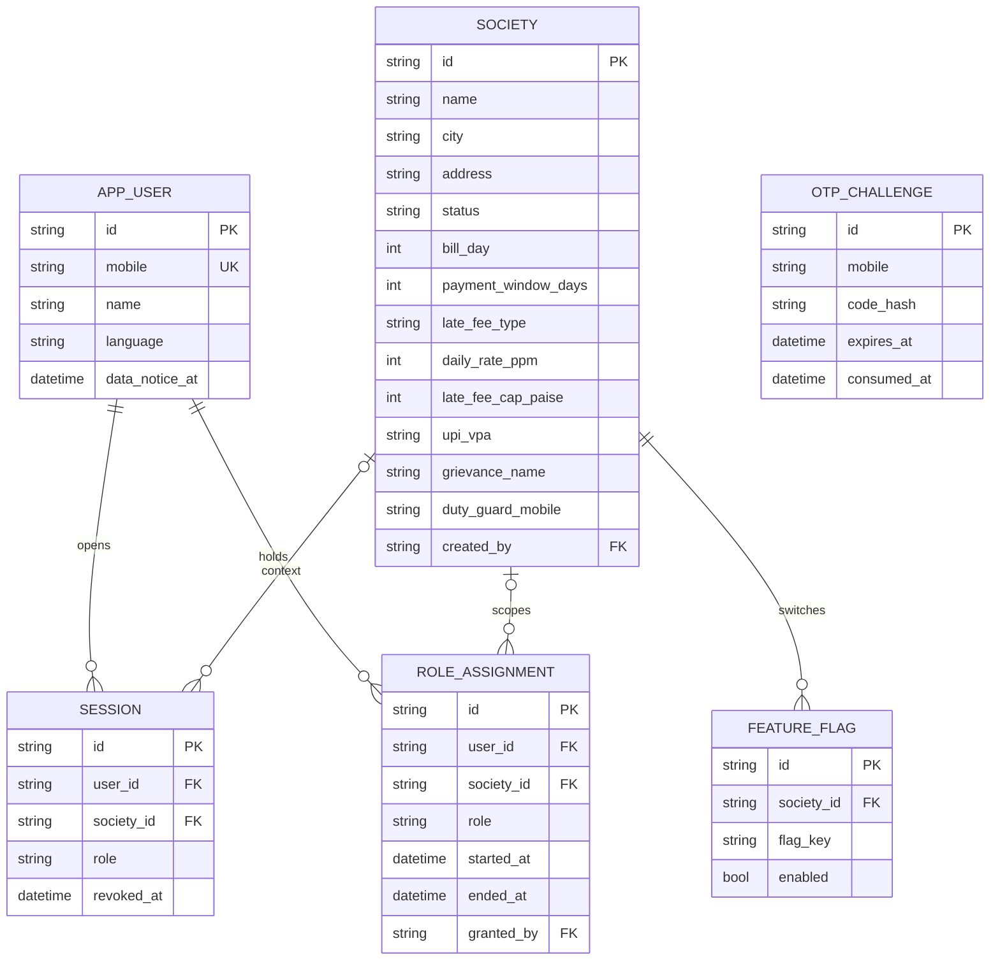

- `SOCIETY.status`: `draft`, `active`, `suspended`. New societies start as `draft`.
- `payment_window_days` is 5 to 10. Default 10. That window is the only grace.
- `late_fee_type`: `simple` or `growing`. Default `simple`. `daily_rate_ppm` of 500 means 0.05% per day. `late_fee_cap_paise` is null until the bye-laws are read.
- `upi_vpa` must contain `@`. The app never stores a UPI PIN or a bank password.
- `ROLE_ASSIGNMENT.role`: `system_admin`, `secretary`, `treasurer`, `facility_manager`. Resident access is an `OCCUPANCY`, not a role row. `society_id` is null only for `system_admin`.
- One open assignment per society per committee role. Replacing a person sets `ended_at` on the old row. Old actions keep the old `user_id`.
- `SESSION.society_id` is null only for a system admin. `SESSION.role` is the only role that token may call.
- `FEATURE_FLAG.flag_key`: `services`, `gate`, `face_check`, `whatsapp_auto`. Created off.
- `OTP_CHALLENGE` is not linked to a society. The raw code is not stored.

## 3. Flats, people, parking, papers

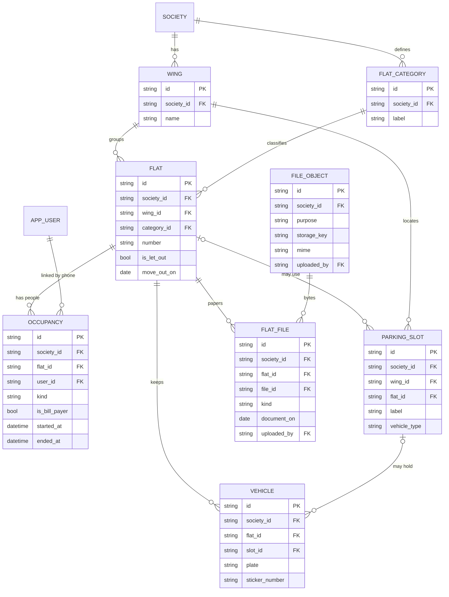

- Flat identity is unique on `(society_id, wing_id, number)`.
- `FLAT_CATEGORY.label` starts as 1RK, 1BHK, 2BHK, 3BHK, penthouse, shop. A society can add a label.
- `OCCUPANCY.kind`: `owner`, `tenant`, `extra`. The owner is the bill payer until a secretary switches that flag to the tenant. Partial unique index: one open `is_bill_payer` per flat.
- A phone that is not yet verified still gets an `APP_USER` at import, so reminders have somewhere to go. The first OTP is what sets the language.
- Changing a person’s phone updates `APP_USER.mobile`. It does not rewrite old ledger or audit rows. Replacing a person ends the occupancy and starts another. History stays on the old user.
- `PARKING_SLOT.vehicle_type`: `car` or `bike`, or a label the society adds. No barrier, camera, or guard login.
- `FLAT_FILE.kind`: `rental_agreement` or `police_verification`. Readable by the secretary and by occupancies of that flat. Other flats cannot open it. FacilityCore does not perform police verification.
- `FILE_OBJECT` is the only file store. Receipts, screenshots, complaint photos, and the vault point here. Access follows the parent row. Files sit in an Indian region.

## 4. Charges and bills

A sent line is a snapshot. Editing a charge item later does not change a bill already sent.

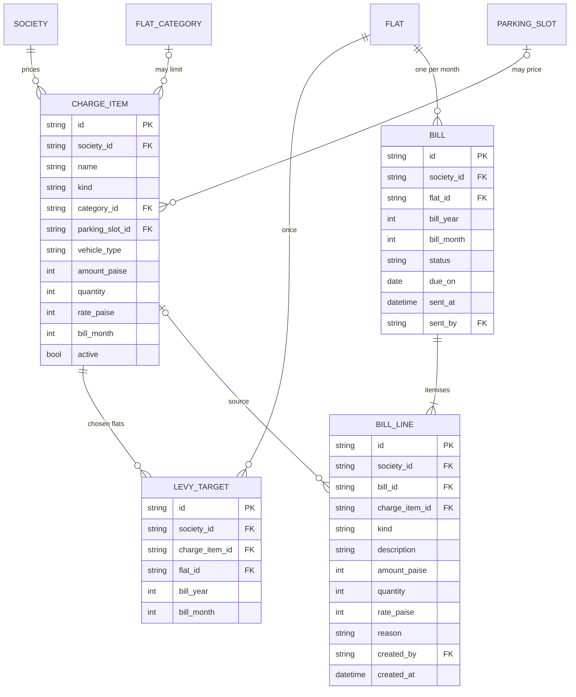

- `CHARGE_ITEM.kind`: `monthly`, `annual`, `fund`, `levy`, `parking`, `non_occupancy`.
- `category_id` null means every flat. Set it to charge a 2BHK differently from a shop.
- `bill_month` is used when `kind` is `annual`. A levy uses `LEVY_TARGET` instead, one row per chosen flat for that month.
- `quantity` and `rate_paise` stay null until a later water-meter charge fills them. The bill line copies them.
- Parking: if `parking_slot_id` is set, the line is added only to that slot’s flat. If `kind` is `parking`, the slot is null, and `vehicle_type` is set, the run adds the amount once per linked slot of that type on the flat.
- Non-occupancy ships inactive. The run adds it only when the item is active and `FLAT.is_let_out` is true. No legal percentage is built in.
- `BILL` is unique on `(society_id, flat_id, bill_year, bill_month)`. A second run does nothing for a flat that already has that month.
- `BILL.status`: `draft`, `sent`, `partially_paid`, `awaiting_confirmation`, `paid`. Residents cannot read a draft.
- Status is updated in this order: a `reported` payment makes it `awaiting_confirmation`; balance 0 makes it `paid`; some credit and a remaining balance makes it `partially_paid`; otherwise `sent`.
- `due_on` is the bill date plus `payment_window_days`. Late fees start the next day.
- An adjustment inserts a `BILL_LINE` and a `LEDGER_ENTRY`. The original lines stay. `reason` and `created_by` are required on an adjustment.

## 5. Ledger, payments, deposits

This is the money model. The flat balance is the sum of its ledger. Interior deposits are not in that sum.

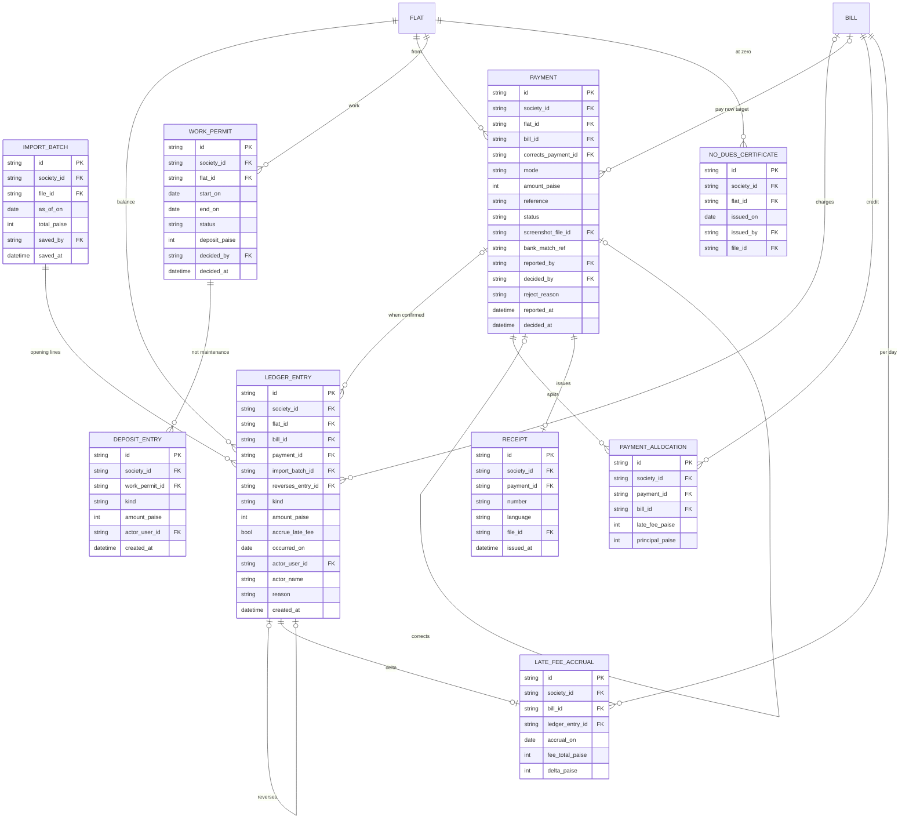

- `LEDGER_ENTRY.kind`: `opening`, `charge`, `late_fee`, `payment`, `adjustment`, `waiver`, `bounce`, `bounce_charge`, `refund`.
- Opening line: positive if the flat owes, negative if it is in advance. `accrue_late_fee` is false unless the secretary opts in for that flat. Charge lines always accrue.
- `PAYMENT.mode`: `upi`, `cash`, `cheque`. `PAYMENT.status`: `reported`, `confirmed`, `rejected`.
- Unique UPI reference per society among `reported` and `confirmed`. Cheque numbers are stored and are not under that unique rule. Cash may have a null reference.
- Confirm writes the payment ledger row (negative), then `PAYMENT_ALLOCATION` rows: late fees first, then oldest unpaid bill. `bank_match_ref` stays null. Matching is manual in this phase.
- A bounced cheque writes `bounce` for the same amount (positive) and may write `bounce_charge`. Late fees use the original `due_on`.
- A payment on the wrong flat is not moved. The ledger is reversed with a reason, and a new payment is written on the right flat through `corrects_payment_id`.
- `LATE_FEE_ACCRUAL` is unique on `(bill_id, accrual_on)`. The job stores that day’s fee total and posts only `delta_paise`, so a rerun does not double-charge.
- Simple fee total = unpaid principal × daily rate × late days. Growing amount due = principal × (1 + daily rate) ^ late days. The growing check is Rs 3,000 at 500 ppm: Rs 3,001.50 on the first late day, Rs 3,015.03 after 10 late days. A cap, when set, stops the fee. Waivers are `waiver` rows. Only a secretary can write one, and `reason` is required.
- `WORK_PERMIT.status`: `submitted`, `approved`, `refused`. `DEPOSIT_ENTRY.kind`: `collect`, `refund`. No foreign key from either table to `LEDGER_ENTRY`.
- A no-dues certificate can be inserted only when the flat’s ledger sum is 0. Dues stay on the flat after `move_out_on`.

## 6. Helpdesk, community, documents

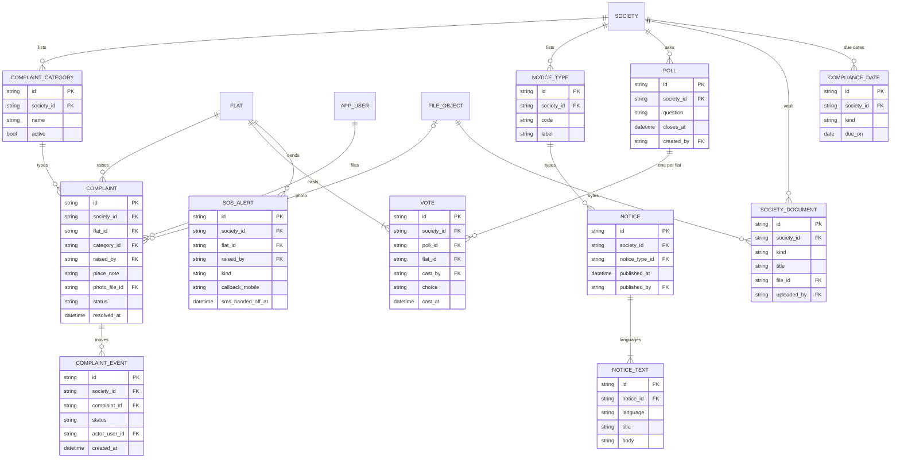

- Complaint categories are seeded per society: plumbing, electrical, lift, drainage choke, seepage, water supply, DG and power backup, parking, noise, common-area cleaning. The secretary can add one. No release required.
- `COMPLAINT.status`: `pending`, `in_progress`, `resolved`. The guard is not a recipient. Within 7 days of `resolved_at` the resident can reopen, which appends a `pending` event.
- Notice types are seeded: water, tanker, lift, meeting, general. A notice does not create a bill and does not collect a vote. `NOTICE_TEXT` holds en, hi, and mr. The home screen uses the resident’s language.
- `VOTE` is unique on `(poll_id, flat_id)`. The open bill payer casts it. Choice is `yes` or `no`.
- `SOS_ALERT.kind`: `medical`, `fire`, `security`. SMS goes to the open secretary, the open facility manager, and `duty_guard_mobile`, with flat number and callback phone. `sms_handed_off_at` minus `created_at` is tested against 10 seconds.
- `SOCIETY_DOCUMENT.kind`: `bye_laws`, `occupancy_certificate`, `fire_noc`, `lift_licence`, `insurance`, `minutes`. Any resident of that society can read them.
- `COMPLIANCE_DATE.kind`: `lift_amc`, `fire_noc`, `building_insurance`, `agm`. The dashboard lists rows due within 30 days. This does not book a job.

## 7. Messages, privacy, and the seams

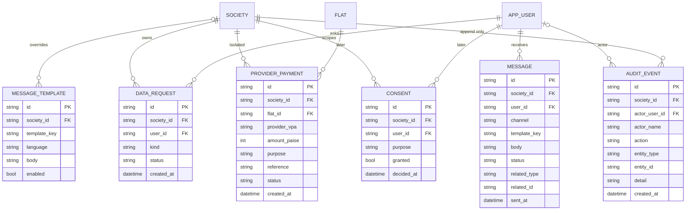

- `MESSAGE_TEMPLATE.template_key`: `otp`, `bill_sent`, `reminder_before`, `reminder_due`, `late_started`, `weekly_balance`, `complaint_status`, `payment_rejected`, `sos`. One row per language. `society_id` null is the platform default. A society row overrides it. The secretary can set `enabled` false. OTP uses the same SMS path and cannot be switched off.
- `MESSAGE.channel`: `sms` or `in_app`. Share-on-WhatsApp is not a row: the phone opens WhatsApp and the resident sends it. Automatic WhatsApp is the `whatsapp_auto` flag, which is off, and a future `CONSENT.purpose` of `whatsapp_reminders`.
- `DATA_REQUEST.kind`: `see_my_data` or `society_export`. It is stored for the grievance contact. Profile shows `SOCIETY.grievance_name`.
- `CONSENT.purpose` later: `whatsapp_reminders`, `face_check`. No rows in this phase.
- `PROVIDER_PAYMENT.provider_vpa` is not `SOCIETY.upi_vpa`. Insert is allowed for a later priced service. Any API that would allocate it to a bill or a ledger row is refused.
- `AUDIT_EVENT` has no update and no delete. Reject, role grant, suspend, handover, waiver, and bill send are all rows here. `actor_name` is copied at write time so a later rename does not rewrite history.
- An opened bill may be cached on the phone. Pay, complaints, and SOS need a connection. Backup is an operations job, every day, kept 30 days. It is not a table.

### Where later work attaches

| Later work | Uses rows that exist now | Does not get a table yet |
| --- | --- | --- |
| Priced home services | `PROVIDER_PAYMENT`, flag `services` | vendor, catalogue, slot booking |
| Society services paid back through dues | a `levy` charge item | a second ledger |
| Automatic WhatsApp | `CONSENT`, `MESSAGE`, flag `whatsapp_auto` | a WhatsApp API call in this phase |
| Gate, after a poll | `VEHICLE`, `PARKING_SLOT`, `FLAT_FILE`, flag `gate` | visitor, guest code, guard login |
| Face check, after a privacy review | `CONSENT`, flag `face_check` | face template |
| Metered water | `quantity` and `rate_paise` on the charge and the line | a meter table |

Held out, with no extension point: local vendors and the 2 km directory, a payment gateway, commission, NACH, GST returns, payroll, redevelopment, rent receipts for HRA, Aadhaar face match, boom barriers.

## 8. Coverage

| Feature | Stored as |
| --- | --- |
| F36 Onboard a society | `SOCIETY`, `FEATURE_FLAG`, `AUDIT_EVENT` |
| F37 Committee access | `ROLE_ASSIGNMENT` with `ended_at` |
| F01 OTP, roles, language | `OTP_CHALLENGE`, `SESSION`, `APP_USER.language`, `APP_USER.data_notice_at` |
| F02 Rules and UPI ID | columns on `SOCIETY` |
| F03 Flats, people, Excel | `FLAT`, `OCCUPANCY`, `APP_USER`, `IMPORT_BATCH` |
| F04 Opening balances | `LEDGER_ENTRY.kind = opening`, `accrue_late_fee` |
| F05 Wings and categories | `WING`, `FLAT_CATEGORY` |
| F06 Parking and vehicles | `PARKING_SLOT`, `VEHICLE` |
| F07 Handover | close and open `ROLE_ASSIGNMENT`; audit keeps the old actor |
| F08 Charge catalogue | `CHARGE_ITEM`, snapshot on `BILL_LINE` |
| F09 Funds, levies, non-occupancy, parking | `CHARGE_ITEM.kind`, `LEVY_TARGET`, `FLAT.is_let_out` |
| F10 Draft, review, send, correct | `BILL`, `BILL_LINE` adjustment |
| F11 No double charge | unique `(society_id, flat_id, bill_year, bill_month)` |
| F12 UPI intent and QR | no table; `SOCIETY.upi_vpa` and the amount due |
| F13 UTR, confirm, reject | `PAYMENT`, ledger only on confirm |
| F14 Block a reused UTR | unique live reference per society |
| F15 Cash, cheque, repairs | `PAYMENT.mode`, `bounce`, `refund`, `corrects_payment_id` |
| F16 Statement and receipt | ledger list, `RECEIPT` |
| F17 Move-out and no-dues | `FLAT.move_out_on`, `NO_DUES_CERTIFICATE` |
| F18 Tenancy papers | `FLAT_FILE` |
| F19 Interior deposit | `WORK_PERMIT`, `DEPOSIT_ENTRY`, no ledger FK |
| F20 Late fee and waiver | `LATE_FEE_ACCRUAL`, `LEDGER_ENTRY.kind = waiver` |
| F21 SMS and in-app reminders | `MESSAGE_TEMPLATE`, `MESSAGE` |
| F22 Share on WhatsApp | no row; the resident sends it |
| F23 Defaulter list | a query on ledger and due date; resident token refused |
| F24 Helpdesk and SLA | `COMPLAINT`, `COMPLAINT_EVENT` |
| F25 Complaint categories | `COMPLAINT_CATEGORY` |
| F26 Local vendors | no table |
| F27 Polls | `POLL`, `VOTE` unique per flat |
| F28 SOS | `SOS_ALERT`, `SOCIETY.duty_guard_mobile` |
| F29 Notices | `NOTICE`, `NOTICE_TEXT`, `NOTICE_TYPE` |
| F30 Vault and due dates | `SOCIETY_DOCUMENT`, `COMPLIANCE_DATE` |
| F31 Dashboard, Excel, history | queries plus `AUDIT_EVENT` and `LEDGER_ENTRY` |
| F32 April–March export | same rows, filtered; fund kinds totalled apart |
| F33 Backup, speed, roles | backup is operational; role is `SESSION.role` |
| F34 Privacy | `DATA_REQUEST`, `grievance_name`, Indian file region |
| F35 Flags and the service seam | `FEATURE_FLAG`, `PROVIDER_PAYMENT`, `CONSENT`, shared `FILE_OBJECT` |

## 9. Sequences

### Onboard a society and name who runs it

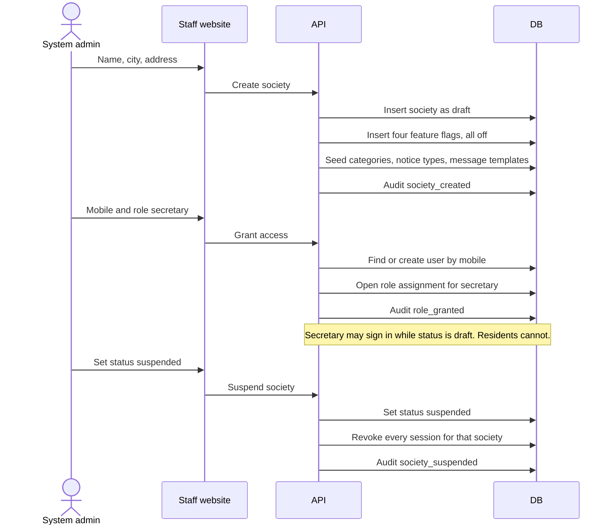

### Sign in, language, and one role per token

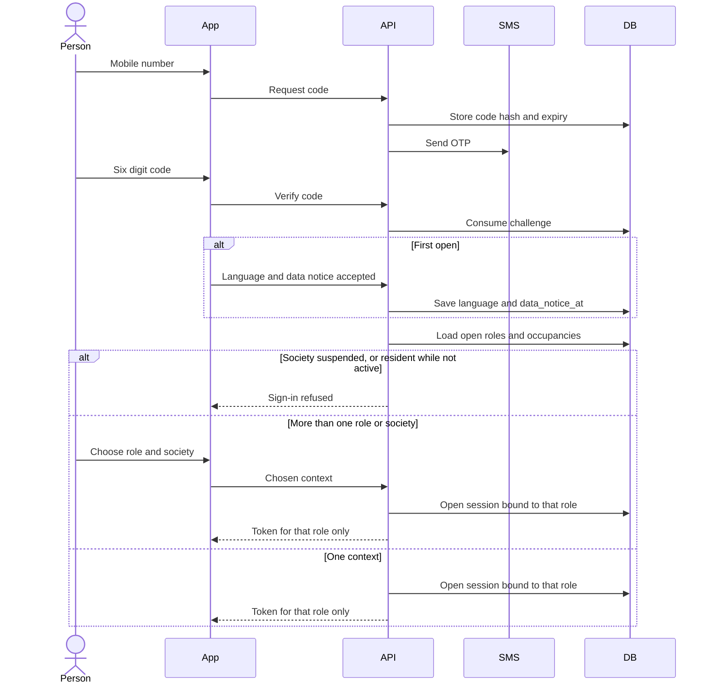

Profile can change `language` later. The same phone in a new role asks for a new token. Logout sets `revoked_at`.

### Flats, people, and opening balances

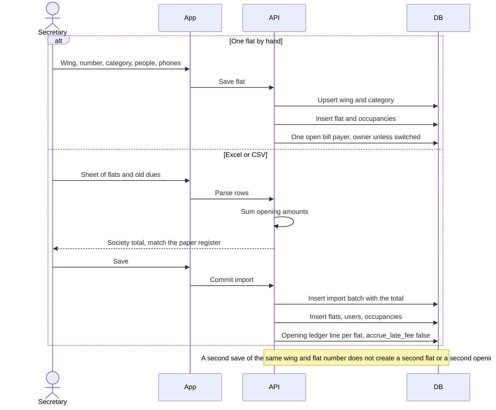

Opting a flat in for late fees on the old due sets `accrue_late_fee` on that opening line only.

### Handover

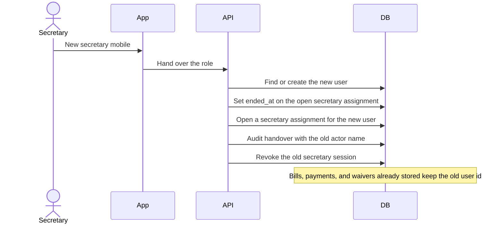

### Settings and charges

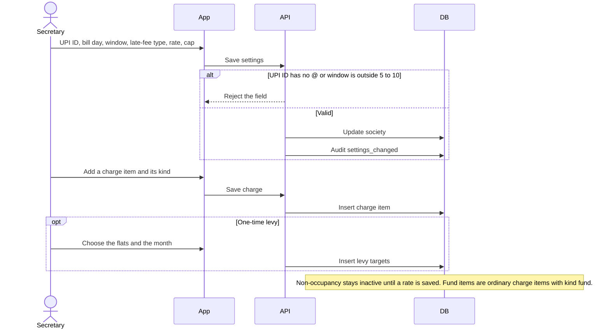

### Draft, send, and correct a bill

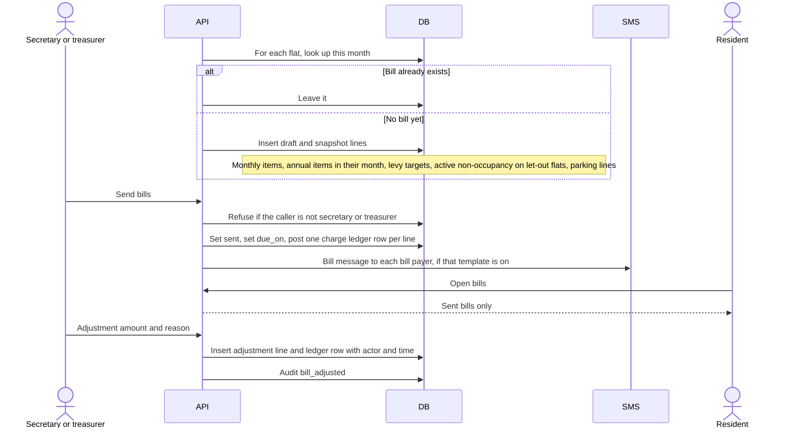

### Pay by UPI and report the reference

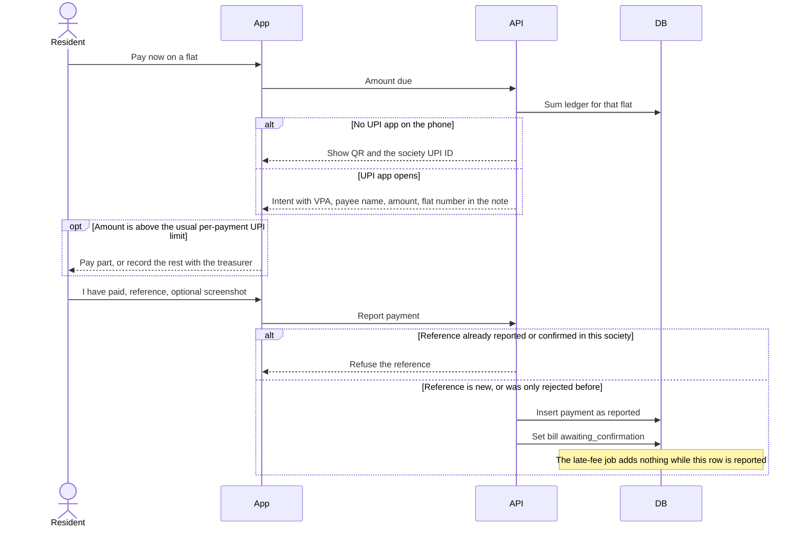

Home is derived. Balance above zero and no reported payment: due. A reported payment: waiting. Balance at or below zero: clear.

### Confirm or reject

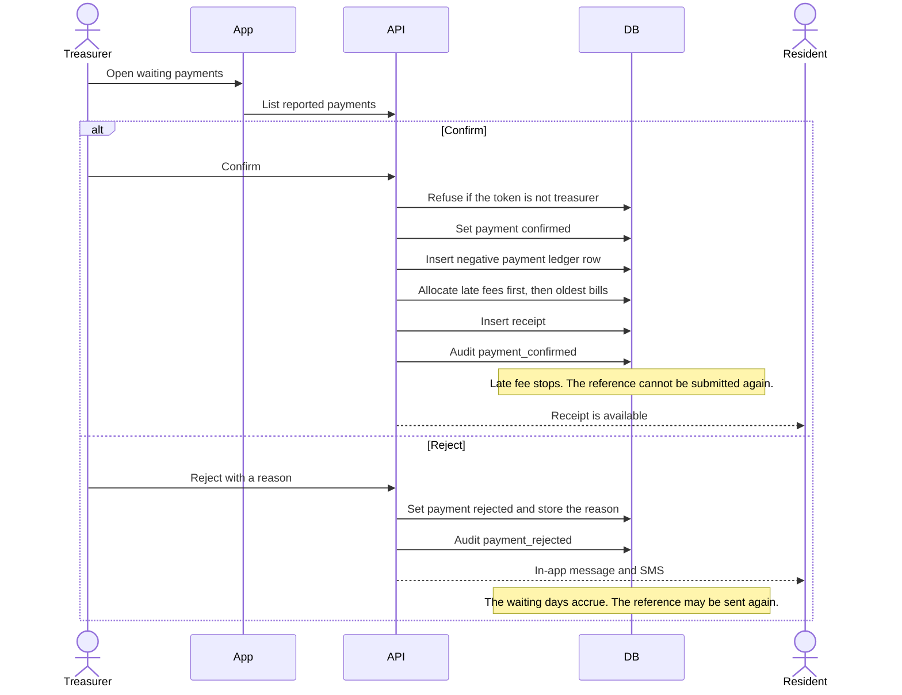

### Cash, cheque, bounce, advance, and a payment on the wrong flat

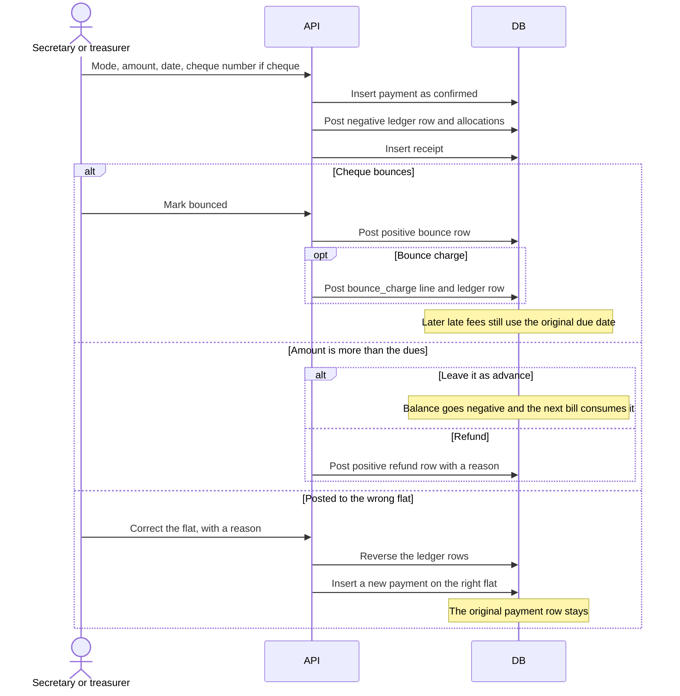

A short payment leaves a positive balance and the bill stays `partially_paid`.

### Late fees, reminders, and the defaulter list

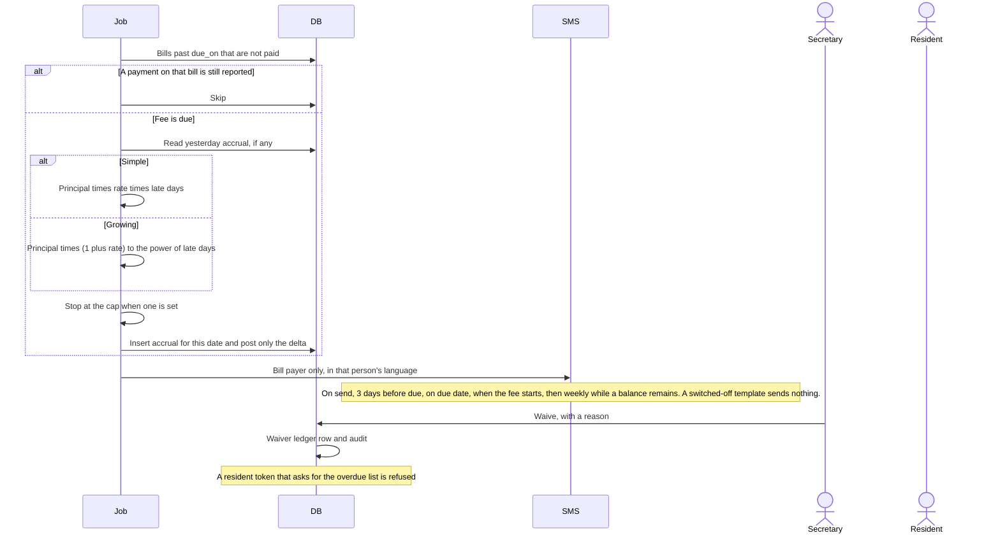

The opening balance is included in the principal only when that ledger row has `accrue_late_fee`.

### Statement, receipt, share, move-out

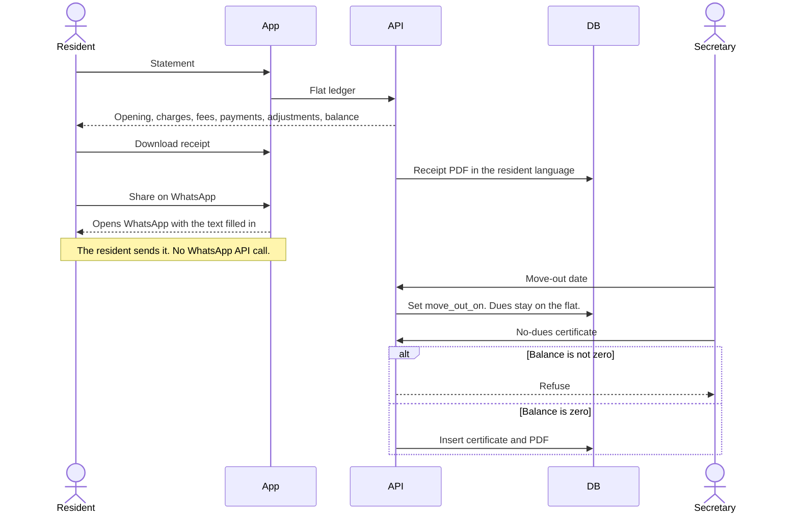

### Tenancy papers and the interior deposit

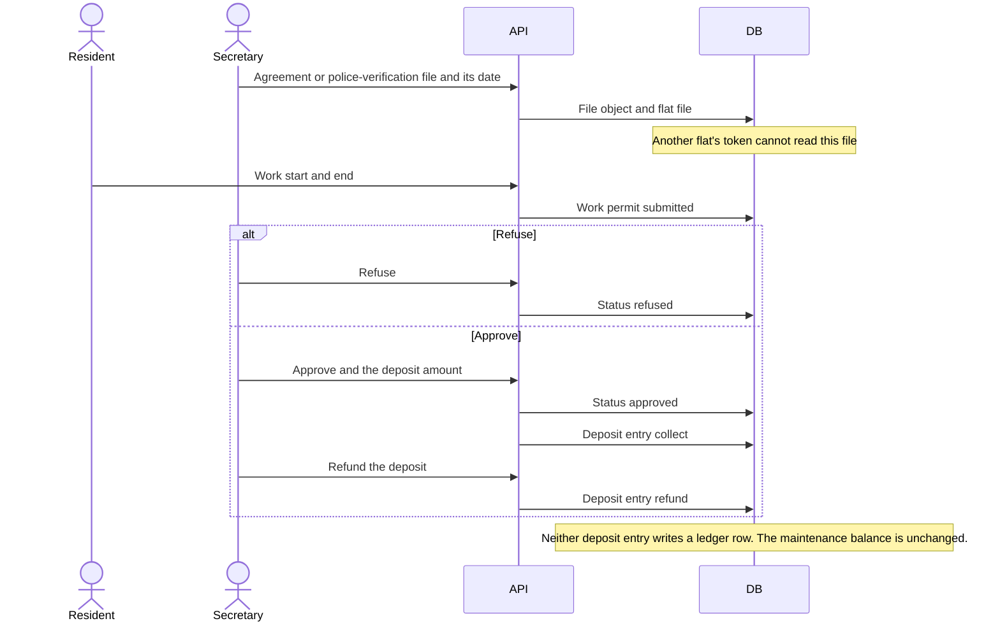

### Complaints

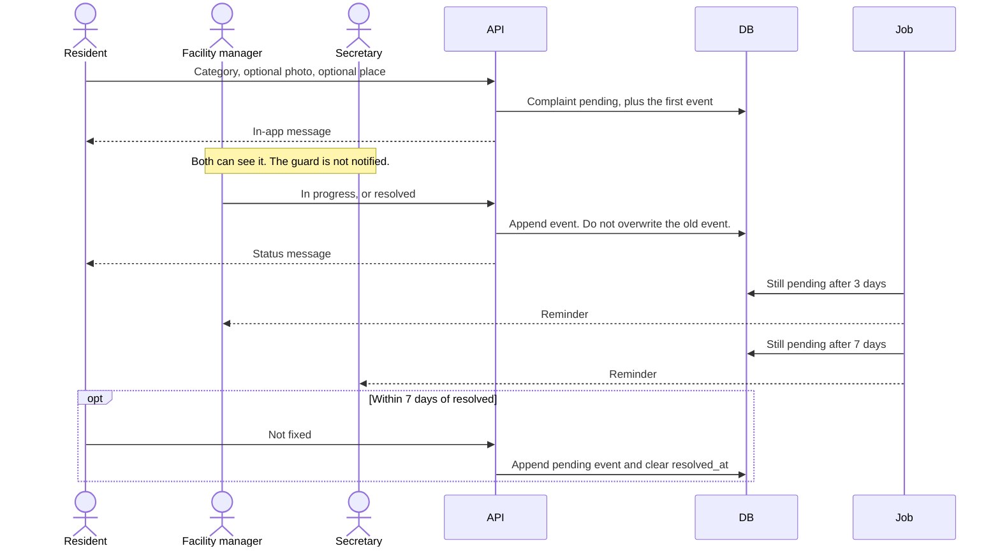

The secretary can add a complaint category. That is an insert into `COMPLAINT_CATEGORY`.

### Polls, notices, SOS, and the vault

```mermaid
sequenceDiagram
    actor Secretary
    actor Resident
    participant API
    participant DB
    participant SMS

    Secretary->>API: Yes or no question and a closing time
    API->>DB: Insert poll
    Resident->>API: Yes or no
    API->>DB: Refuse if the caller is not the open bill payer
    API->>DB: Refuse if this flat already has a vote or the poll has closed
    API->>DB: Insert vote
    API-->>Resident: Running yes and no counts
    Secretary->>API: Notice type, and title plus body per language
    API->>DB: Insert notice and notice texts
    Note over Resident: Home shows the text for the resident language. No bill is created.
    Resident->>API: SOS kind
    API->>DB: Insert alert with flat and callback mobile
    API->>SMS: Secretary, facility manager, and the duty-guard number
    API->>DB: Set sms_handed_off_at
    Note over SMS: Handoff is tested against 10 seconds. The guard has no login.
    Secretary->>API: Vault file or a compliance date
    API->>DB: Society document or compliance date
    Note over DB: A date inside 30 days is listed on the committee dashboard
```

### Reports, history, privacy, and service money

```mermaid
sequenceDiagram
    actor Committee as Secretary or treasurer
    actor Resident
    participant API
    participant DB

    Committee->>API: Dashboard for a month or for April to March
    API->>DB: Sum collected, pending, overdue, late fees, waiting
    API->>DB: Sum fund kinds apart from ordinary charges
    API-->>Committee: Figures and an Excel file
    Note over API: Overdue excludes drafts and excludes payments still reported. A resident token is refused.
    Committee->>API: Money history
    API-->>Committee: Ledger and audit rows, read only
    Resident->>API: See my data
    API->>DB: Insert data request for the grievance contact
    Committee->>API: Download society data
    API->>DB: Insert society_export request and return the rows
    API->>DB: Attempt to allocate a provider payment to a bill
    API-->>API: Refuse
    Note over DB: With the four flags off, the resident payload has no booking, visitor, or vendor block
```
