# FacilityCore ER diagram

One diagram, every table. `PROVIDER_PAYMENT` has no line to `BILL` or `LEDGER_ENTRY`. `OTP_CHALLENGE` has no foreign key. A positive `amount_paise` means the flat owes the society.

Open this preview wide, or paste the diagram into [mermaid.live](https://mermaid.live) and export PDF or SVG.

```mermaid
erDiagram
    APP_USER ||--o{ SESSION : "opens"
    SOCIETY |o--o{ SESSION : "context"
    APP_USER ||--o{ ROLE_ASSIGNMENT : "holds"
    APP_USER ||--o{ ROLE_ASSIGNMENT : "grants"
    SOCIETY |o--o{ ROLE_ASSIGNMENT : "scopes"
    APP_USER ||--o{ SOCIETY : "creates"
    SOCIETY ||--o{ FEATURE_FLAG : "switches"
    SOCIETY ||--o{ WING : "has"
    SOCIETY ||--o{ FLAT_CATEGORY : "defines"
    SOCIETY ||--o{ FLAT : "contains"
    WING ||--o{ FLAT : "groups"
    FLAT_CATEGORY ||--o{ FLAT : "classifies"
    SOCIETY ||--o{ OCCUPANCY : "scopes"
    FLAT ||--o{ OCCUPANCY : "houses"
    APP_USER ||--o{ OCCUPANCY : "person"
    SOCIETY ||--o{ PARKING_SLOT : "registers"
    WING ||--o{ PARKING_SLOT : "locates"
    FLAT |o--o{ PARKING_SLOT : "may use"
    SOCIETY ||--o{ VEHICLE : "registers"
    FLAT ||--o{ VEHICLE : "keeps"
    PARKING_SLOT |o--o{ VEHICLE : "may hold"
    SOCIETY ||--o{ FILE_OBJECT : "stores"
    APP_USER ||--o{ FILE_OBJECT : "uploads"
    SOCIETY ||--o{ FLAT_FILE : "scopes"
    FLAT ||--o{ FLAT_FILE : "papers"
    FILE_OBJECT ||--o{ FLAT_FILE : "bytes"
    APP_USER ||--o{ FLAT_FILE : "uploads"
    SOCIETY ||--o{ CHARGE_ITEM : "prices"
    FLAT_CATEGORY |o--o{ CHARGE_ITEM : "limits"
    PARKING_SLOT |o--o{ CHARGE_ITEM : "prices"
    SOCIETY ||--o{ LEVY_TARGET : "scopes"
    CHARGE_ITEM ||--o{ LEVY_TARGET : "targets"
    FLAT ||--o{ LEVY_TARGET : "chosen"
    SOCIETY ||--o{ BILL : "runs"
    FLAT ||--o{ BILL : "billed"
    APP_USER |o--o{ BILL : "sends"
    SOCIETY ||--o{ BILL_LINE : "scopes"
    BILL ||--|{ BILL_LINE : "itemises"
    CHARGE_ITEM |o--o{ BILL_LINE : "snapshots"
    APP_USER |o--o{ BILL_LINE : "adjusts"
    SOCIETY ||--o{ IMPORT_BATCH : "imports"
    FILE_OBJECT ||--o| IMPORT_BATCH : "sheet"
    APP_USER ||--o{ IMPORT_BATCH : "saves"
    SOCIETY ||--o{ LEDGER_ENTRY : "scopes"
    FLAT ||--o{ LEDGER_ENTRY : "balance"
    BILL |o--o{ LEDGER_ENTRY : "posts"
    PAYMENT |o--o{ LEDGER_ENTRY : "clears"
    IMPORT_BATCH |o--o{ LEDGER_ENTRY : "opens"
    LEDGER_ENTRY |o--o| LEDGER_ENTRY : "reverses"
    APP_USER ||--o{ LEDGER_ENTRY : "actor"
    SOCIETY ||--o{ PAYMENT : "scopes"
    FLAT ||--o{ PAYMENT : "pays"
    BILL |o--o{ PAYMENT : "against"
    PAYMENT |o--o| PAYMENT : "corrects"
    FILE_OBJECT |o--o{ PAYMENT : "screenshot"
    APP_USER ||--o{ PAYMENT : "reports"
    APP_USER ||--o{ PAYMENT : "decides"
    SOCIETY ||--o{ PAYMENT_ALLOCATION : "scopes"
    PAYMENT ||--o{ PAYMENT_ALLOCATION : "splits"
    BILL ||--o{ PAYMENT_ALLOCATION : "credit"
    SOCIETY ||--o{ LATE_FEE_ACCRUAL : "scopes"
    BILL ||--o{ LATE_FEE_ACCRUAL : "grows"
    LEDGER_ENTRY ||--o| LATE_FEE_ACCRUAL : "delta"
    SOCIETY ||--o{ RECEIPT : "scopes"
    PAYMENT ||--o| RECEIPT : "proves"
    FILE_OBJECT ||--o| RECEIPT : "pdf"
    SOCIETY ||--o{ WORK_PERMIT : "scopes"
    FLAT ||--o{ WORK_PERMIT : "work"
    APP_USER |o--o{ WORK_PERMIT : "decides"
    SOCIETY ||--o{ DEPOSIT_ENTRY : "scopes"
    WORK_PERMIT ||--o{ DEPOSIT_ENTRY : "deposit"
    APP_USER ||--o{ DEPOSIT_ENTRY : "actor"
    SOCIETY ||--o{ NO_DUES_CERTIFICATE : "scopes"
    FLAT ||--o{ NO_DUES_CERTIFICATE : "clears"
    APP_USER ||--o{ NO_DUES_CERTIFICATE : "issues"
    FILE_OBJECT ||--o{ NO_DUES_CERTIFICATE : "pdf"
    SOCIETY ||--o{ COMPLAINT_CATEGORY : "lists"
    SOCIETY ||--o{ COMPLAINT : "scopes"
    FLAT ||--o{ COMPLAINT : "raises"
    COMPLAINT_CATEGORY ||--o{ COMPLAINT : "types"
    APP_USER ||--o{ COMPLAINT : "files"
    FILE_OBJECT |o--o{ COMPLAINT : "photo"
    SOCIETY ||--o{ COMPLAINT_EVENT : "scopes"
    COMPLAINT ||--o{ COMPLAINT_EVENT : "moves"
    APP_USER ||--o{ COMPLAINT_EVENT : "acts"
    SOCIETY ||--o{ NOTICE_TYPE : "lists"
    SOCIETY ||--o{ NOTICE : "scopes"
    NOTICE_TYPE ||--o{ NOTICE : "types"
    APP_USER ||--o{ NOTICE : "publishes"
    NOTICE ||--|{ NOTICE_TEXT : "translates"
    SOCIETY ||--o{ POLL : "asks"
    APP_USER ||--o{ POLL : "writes"
    SOCIETY ||--o{ VOTE : "scopes"
    POLL ||--o{ VOTE : "collects"
    FLAT ||--o{ VOTE : "one vote"
    APP_USER ||--o{ VOTE : "casts"
    SOCIETY ||--o{ SOS_ALERT : "scopes"
    FLAT ||--o{ SOS_ALERT : "sends"
    APP_USER ||--o{ SOS_ALERT : "raises"
    SOCIETY ||--o{ SOCIETY_DOCUMENT : "vault"
    FILE_OBJECT ||--o{ SOCIETY_DOCUMENT : "bytes"
    APP_USER ||--o{ SOCIETY_DOCUMENT : "uploads"
    SOCIETY ||--o{ COMPLIANCE_DATE : "watches"
    SOCIETY |o--o{ MESSAGE_TEMPLATE : "overrides"
    SOCIETY ||--o{ MESSAGE : "scopes"
    APP_USER ||--o{ MESSAGE : "receives"
    SOCIETY ||--o{ DATA_REQUEST : "owns"
    APP_USER ||--o{ DATA_REQUEST : "asks"
    SOCIETY ||--o{ CONSENT : "scopes"
    APP_USER ||--o{ CONSENT : "decides"
    SOCIETY ||--o{ PROVIDER_PAYMENT : "isolated"
    FLAT ||--o{ PROVIDER_PAYMENT : "later"
    SOCIETY |o--o{ AUDIT_EVENT : "records"
    APP_USER |o--o{ AUDIT_EVENT : "actor"

    APP_USER {
        string id PK
        string mobile UK
        string name
        string language
        datetime data_notice_at
    }
    OTP_CHALLENGE {
        string id PK
        string mobile
        string code_hash
        datetime expires_at
        datetime consumed_at
    }
    SESSION {
        string id PK
        string user_id FK
        string society_id FK
        string role
        datetime revoked_at
    }
    SOCIETY {
        string id PK
        string name
        string city
        string address
        string status
        int bill_day
        int payment_window_days
        string late_fee_type
        int daily_rate_ppm
        int late_fee_cap_paise
        string upi_vpa
        string grievance_name
        string duty_guard_mobile
        string created_by FK
    }
    ROLE_ASSIGNMENT {
        string id PK
        string user_id FK
        string society_id FK
        string role
        datetime started_at
        datetime ended_at
        string granted_by FK
    }
    FEATURE_FLAG {
        string id PK
        string society_id FK
        string flag_key
        bool enabled
    }
    WING {
        string id PK
        string society_id FK
        string name
    }
    FLAT_CATEGORY {
        string id PK
        string society_id FK
        string label
    }
    FLAT {
        string id PK
        string society_id FK
        string wing_id FK
        string category_id FK
        string number
        bool is_let_out
        date move_out_on
    }
    OCCUPANCY {
        string id PK
        string society_id FK
        string flat_id FK
        string user_id FK
        string kind
        bool is_bill_payer
        datetime started_at
        datetime ended_at
    }
    PARKING_SLOT {
        string id PK
        string society_id FK
        string wing_id FK
        string flat_id FK
        string label
        string vehicle_type
    }
    VEHICLE {
        string id PK
        string society_id FK
        string flat_id FK
        string slot_id FK
        string plate
        string sticker_number
    }
    FILE_OBJECT {
        string id PK
        string society_id FK
        string purpose
        string storage_key
        string mime
        string uploaded_by FK
    }
    FLAT_FILE {
        string id PK
        string society_id FK
        string flat_id FK
        string file_id FK
        string kind
        date document_on
        string uploaded_by FK
    }
    CHARGE_ITEM {
        string id PK
        string society_id FK
        string name
        string kind
        string category_id FK
        string parking_slot_id FK
        string vehicle_type
        int amount_paise
        int quantity
        int rate_paise
        int bill_month
        bool active
    }
    LEVY_TARGET {
        string id PK
        string society_id FK
        string charge_item_id FK
        string flat_id FK
        int bill_year
        int bill_month
    }
    BILL {
        string id PK
        string society_id FK
        string flat_id FK
        int bill_year
        int bill_month
        string status
        date due_on
        datetime sent_at
        string sent_by FK
    }
    BILL_LINE {
        string id PK
        string society_id FK
        string bill_id FK
        string charge_item_id FK
        string kind
        string description
        int amount_paise
        int quantity
        int rate_paise
        string reason
        string created_by FK
        datetime created_at
    }
    IMPORT_BATCH {
        string id PK
        string society_id FK
        string file_id FK
        date as_of_on
        int total_paise
        string saved_by FK
        datetime saved_at
    }
    LEDGER_ENTRY {
        string id PK
        string society_id FK
        string flat_id FK
        string bill_id FK
        string payment_id FK
        string import_batch_id FK
        string reverses_entry_id FK
        string kind
        int amount_paise
        bool accrue_late_fee
        date occurred_on
        string actor_user_id FK
        string actor_name
        string reason
        datetime created_at
    }
    PAYMENT {
        string id PK
        string society_id FK
        string flat_id FK
        string bill_id FK
        string corrects_payment_id FK
        string mode
        int amount_paise
        string reference
        string status
        string screenshot_file_id FK
        string bank_match_ref
        string reported_by FK
        string decided_by FK
        string reject_reason
        datetime reported_at
        datetime decided_at
    }
    PAYMENT_ALLOCATION {
        string id PK
        string society_id FK
        string payment_id FK
        string bill_id FK
        int late_fee_paise
        int principal_paise
    }
    LATE_FEE_ACCRUAL {
        string id PK
        string society_id FK
        string bill_id FK
        string ledger_entry_id FK
        date accrual_on
        int fee_total_paise
        int delta_paise
    }
    RECEIPT {
        string id PK
        string society_id FK
        string payment_id FK
        string number
        string language
        string file_id FK
        datetime issued_at
    }
    WORK_PERMIT {
        string id PK
        string society_id FK
        string flat_id FK
        date start_on
        date end_on
        string status
        int deposit_paise
        string decided_by FK
        datetime decided_at
    }
    DEPOSIT_ENTRY {
        string id PK
        string society_id FK
        string work_permit_id FK
        string kind
        int amount_paise
        string actor_user_id FK
        datetime created_at
    }
    NO_DUES_CERTIFICATE {
        string id PK
        string society_id FK
        string flat_id FK
        date issued_on
        string issued_by FK
        string file_id FK
    }
    COMPLAINT_CATEGORY {
        string id PK
        string society_id FK
        string name
        bool active
    }
    COMPLAINT {
        string id PK
        string society_id FK
        string flat_id FK
        string category_id FK
        string raised_by FK
        string place_note
        string photo_file_id FK
        string status
        datetime resolved_at
    }
    COMPLAINT_EVENT {
        string id PK
        string society_id FK
        string complaint_id FK
        string status
        string actor_user_id FK
        datetime created_at
    }
    NOTICE_TYPE {
        string id PK
        string society_id FK
        string code
        string label
    }
    NOTICE {
        string id PK
        string society_id FK
        string notice_type_id FK
        datetime published_at
        string published_by FK
    }
    NOTICE_TEXT {
        string id PK
        string notice_id FK
        string language
        string title
        string body
    }
    POLL {
        string id PK
        string society_id FK
        string question
        datetime closes_at
        string created_by FK
    }
    VOTE {
        string id PK
        string society_id FK
        string poll_id FK
        string flat_id FK
        string cast_by FK
        string choice
        datetime cast_at
    }
    SOS_ALERT {
        string id PK
        string society_id FK
        string flat_id FK
        string raised_by FK
        string kind
        string callback_mobile
        datetime sms_handed_off_at
    }
    SOCIETY_DOCUMENT {
        string id PK
        string society_id FK
        string kind
        string title
        string file_id FK
        string uploaded_by FK
    }
    COMPLIANCE_DATE {
        string id PK
        string society_id FK
        string kind
        date due_on
    }
    MESSAGE_TEMPLATE {
        string id PK
        string society_id FK
        string template_key
        string language
        string body
        bool enabled
    }
    MESSAGE {
        string id PK
        string society_id FK
        string user_id FK
        string channel
        string template_key
        string body
        string status
        string related_type
        string related_id
        datetime sent_at
    }
    DATA_REQUEST {
        string id PK
        string society_id FK
        string user_id FK
        string kind
        string status
        datetime created_at
    }
    CONSENT {
        string id PK
        string society_id FK
        string user_id FK
        string purpose
        bool granted
        datetime decided_at
    }
    PROVIDER_PAYMENT {
        string id PK
        string society_id FK
        string flat_id FK
        string provider_vpa
        int amount_paise
        string purpose
        string reference
        string status
        datetime created_at
    }
    AUDIT_EVENT {
        string id PK
        string society_id FK
        string actor_user_id FK
        string actor_name
        string action
        string entity_type
        string entity_id
        string detail
        datetime created_at
    }
```

